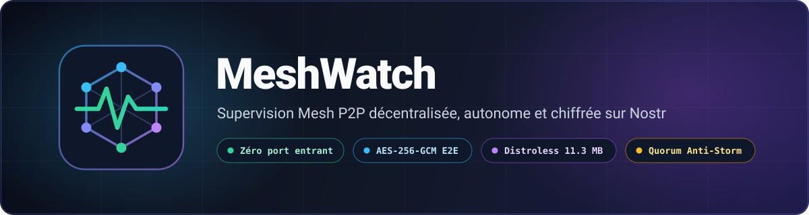
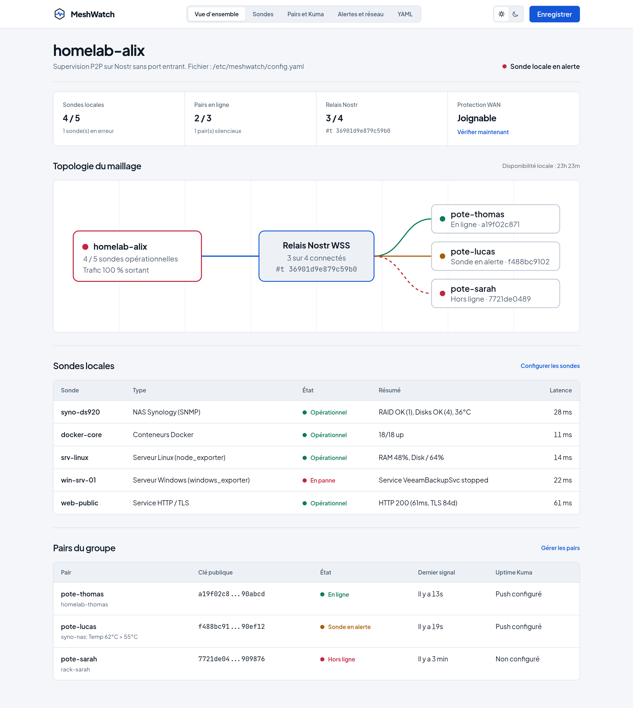
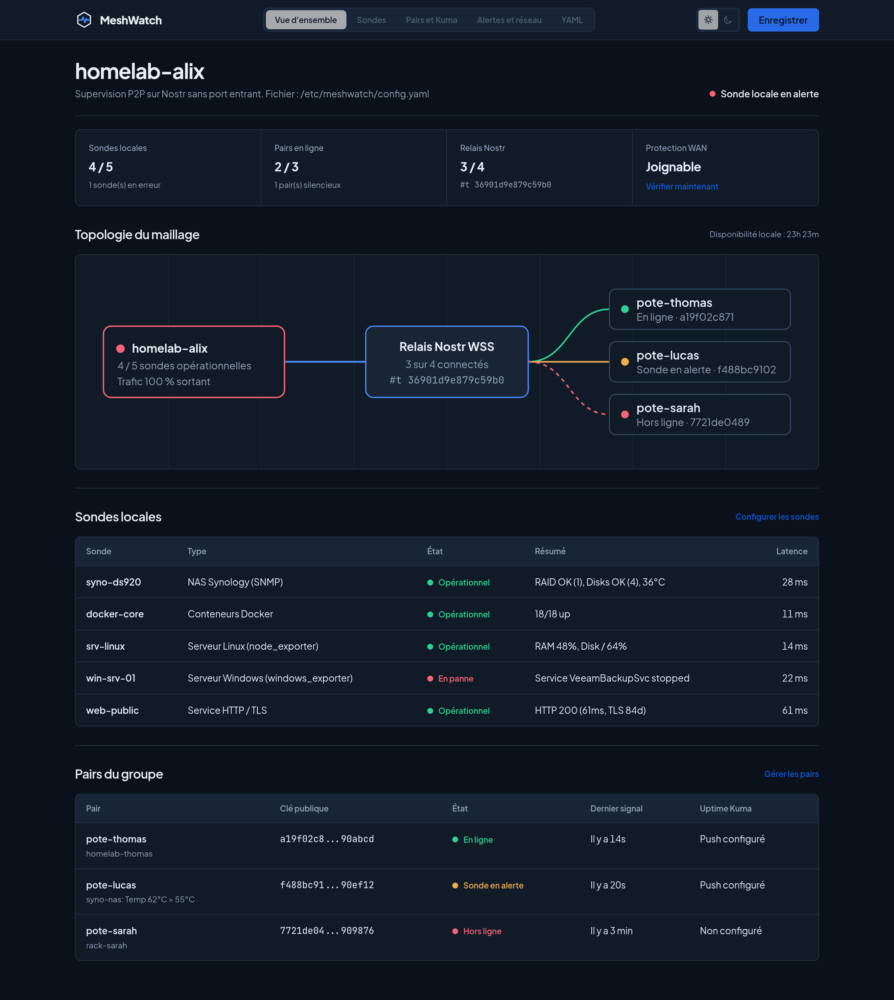
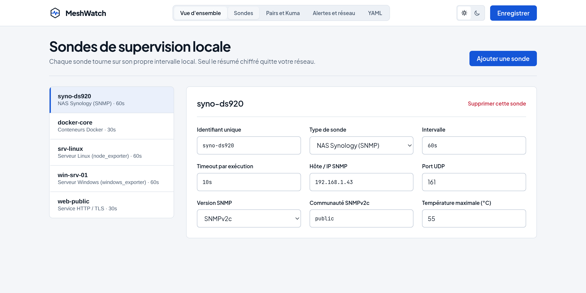
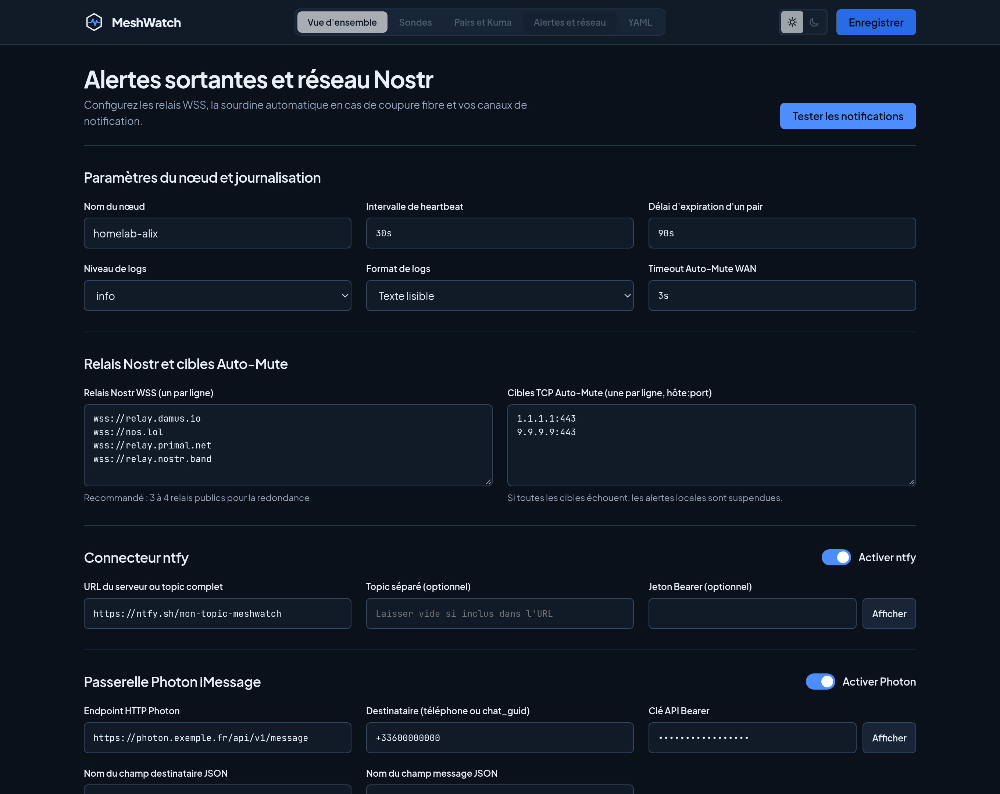
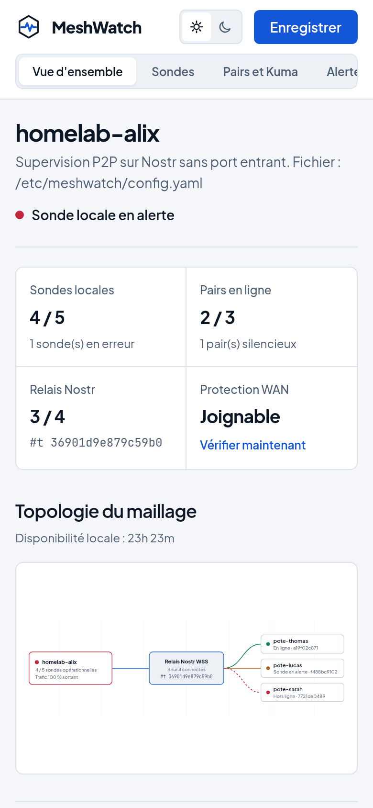
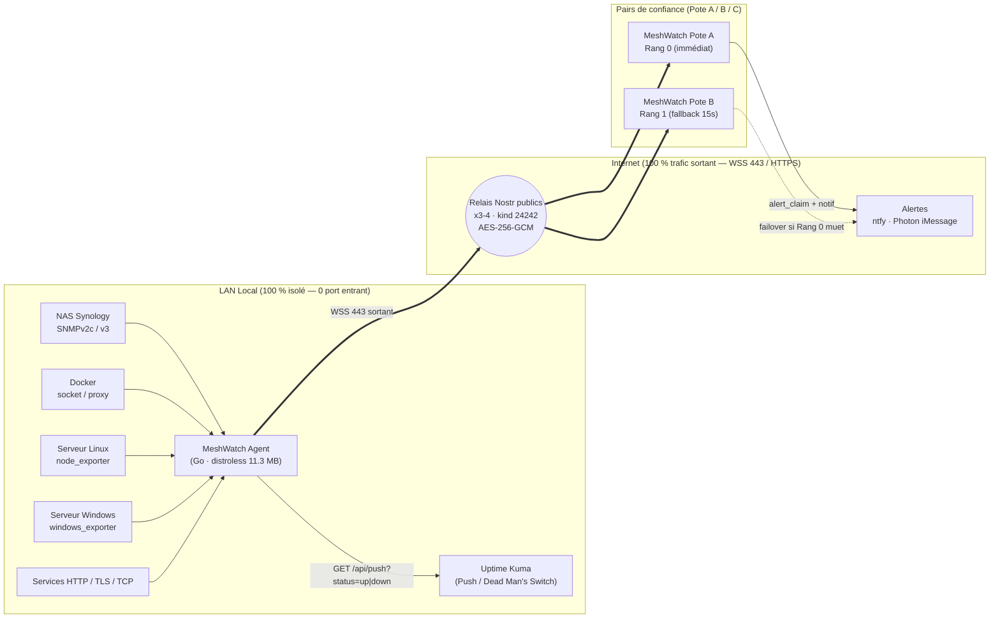

<div align="center">

<picture>
  
</picture>

<br/>

[](https://github.com/AL1X0/meshkuma/actions/workflows/ci.yml)
[](https://go.dev/)
[](Dockerfile)
[-10B981)](#sécurité--protocole-nostr)
[](LICENSE)

**Supervisez vos homelabs entre amis — sans ouvrir aucun port, sans VPS central, et avec chiffrement de bout en bout.**

[Console Web](#console-web-locale-opt-in) · [Architecture](#architecture) · [Fonctionnalités](#fonctionnalités-clés) · [Sondes](#sondes-supportées) · [Démarrage rapide](#démarrage-rapide-en-5-étapes) · [Sécurité](#sécurité--protocole-nostr) · [CLI](#commandes-cli)

</div>

---

## Pourquoi MeshWatch ?

Quand votre fibre tombe ou que votre serveur domestique plante, **votre propre Uptime Kuma local tombe avec lui** et ne peut plus vous prévenir. Louer un VPS juste pour monitorer son homelab ajoute un coût, de la maintenance et un point central.

**MeshWatch** résout ce problème en créant un **maillage P2P de supervision entre amis** :

- Chacun héberge un petit conteneur Docker Go (**11,3 Mo**, `< 30 Mo` de RAM) dans son propre LAN.
- Chaque agent exécute **localement** ses sondes (Synology SNMP, Docker, Linux `node_exporter`, Windows `windows_exporter`, HTTP/TLS, TCP, SNMP générique).
- Il publie périodiquement un résumé JSON **chiffré en AES-256-GCM** via des **relais Nostr publics** (`kind: 24242`, éphémères, jamais stockés sur disque).
- Les pairs abonnés reçoivent ces heartbeats, alimentent leur **Uptime Kuma local (Push / Dead Man's Switch)**, et élisent automatiquement **un seul notificateur** (`ntfy` / **Photon iMessage**) en cas de panne — fini les tempêtes d'alertes !

---

## Console Web locale (opt-in)

Désactivée par défaut pour préserver une surface d'attaque nulle, MeshWatch embarque (`//go:embed`) une **console de configuration et de supervision temps réel** activable en local via `--ui 127.0.0.1:8080` :

- **Topologie SVG temps réel** reliant votre nœud local, vos relais Nostr WSS et vos pairs.
- **Constructeur visuel de sondes** pour les 7 types supportés (SNMPv2c/v3 Synology, Docker, `node_exporter`, `windows_exporter`, HTTP/TLS, TCP, OID SNMP).
- **Gestion des clés & pairs** (`keygen` en un clic, copie `pubkey_hex` / tag `#t`, URLs Push Uptime Kuma).
- **Test des notifications** (`ntfy` & Photon iMessage) directement depuis l'interface, **mode initialisation** si `config.yaml` n'existe pas encore, et **rechargement à chaud** sans redémarrer le conteneur.
- **Thème clair / sombre** intégré, interface responsive mobile, protection par jeton Bearer (`--ui-token`).

### Vue d'ensemble (topologie live, sondes et pairs)

<picture>
  <source media="(prefers-color-scheme: dark)" srcset="assets/screenshots/overview-dark.png">
  <source media="(prefers-color-scheme: light)" srcset="assets/screenshots/overview-light.png">
  
</picture>

<details>
<summary>Voir les deux thèmes (Clair &amp; Sombre) côte à côte</summary>
<br/>

| Thème clair (Pierre &amp; Cobalt) | Thème sombre (Encre marine) |
| :---: | :---: |
|  |  |

</details>

### Configuration des sondes, alertes et vue mobile

| Constructeur visuel de sondes | Alertes (`ntfy` / Photon) &amp; réseau Nostr |
| :---: | :---: |
|  |  |

<div align="center">
  
  <br/>
  <sub>Interface mobile responsive (390×844) : synthèse 2×2 et topologie en direct dès l'ouverture.</sub>
</div>

### Activer la console web locale

```bash
meshwatch run --config config.yaml --ui 127.0.0.1:8080 --ui-token "mon-jeton-local"
```

Avec Docker Compose, décommentez `ports` (`127.0.0.1:8080:8080`) et `MESHWATCH_UI_ADDR` / `MESHWATCH_UI_TOKEN` dans [docker-compose.yml](docker-compose.yml) (retirez `:ro` sur `config.yaml` pour sauvegarder directement depuis la console, ou téléchargez le fichier depuis l'onglet **YAML**).

---

## Architecture



---

## Fonctionnalités clés

| Capacité | Description |
| :--- | :--- |
| **Zéro port entrant** | 100 % du trafic WAN est sortant (`WSS 443` vers les relais Nostr, `HTTPS` vers `ntfy`/Photon). Aucune règle NAT/pare-feu à ouvrir. |
| **Isolation stricte du LAN** | Un pair distant ne peut jamais scanner votre LAN ni exécuter de sonde chez vous : seuls des résumés d'état JSON chiffrés sortent. |
| **Chiffrement E2E & Anti-Rejeu** | Dérivation `HKDF-SHA256`, `AES-256-GCM` (nonce 12 octets), tag de routage `#t` opaque, signatures Schnorr vérifiées, whitelist `peers`, fenêtre `±60s` et déduplication multi-relais. |
| **Auto-Mute (protection coupure fibre)** | Vérifie la connectivité WAN par dial TCP (`1.1.1.1:443`, `9.9.9.9:443`, timeout 3 s) avant toute alerte. Si votre connexion locale tombe, le nœud se met en sourdine (`muted = true`) pour éviter tout faux positif. |
| **Quorum Anti-Alert Storm** | Élection déterministe par ordre lexicographique des `pubkey` en ligne + `alert_claim` sur Nostr : **Rang 0** notifie immédiatement, **Rang 1** attend `15s` en failover, **Rang ≥ 2** attend `30s`. Même logique pour les `RESOLVED`. |
| **Pont Uptime Kuma natif** | Transmet chaque heartbeat valide (`status=up/down`, détail de la sonde fautive dans `msg`, `ping`). Si un pair s'éteint, le Dead Man's Switch d'Uptime Kuma bascule automatiquement en rouge. |
| **Console web opt-in (`--ui`)** | Interface locale embarquée (`//go:embed`) avec topologie SVG temps réel, éditeur visuel de sondes/pairs/alertes, `keygen`, `test-notify`, mode initialisation et hot-reload. |
| **Alertes `ntfy` & Photon iMessage** | Formatage clair (nœud, sonde, résumé, horodatage UTC) avec 3 retries exponentiels (`2s`, `5s`, `10s`) sur erreurs réseau / 5xx et commande `test-notify`. |
| **Empreinte minimale** | Binaire Go statique (`CGO_ENABLED=0`), image `gcr.io/distroless/static-debian12:nonroot` de **11,3 Mo**, système de fichiers en lecture seule (`read_only: true`). |

---

## Sondes supportées

Toutes les sondes tournent de manière concurrente sur leur propre `time.Ticker` avec `context.WithTimeout` pour ne jamais bloquer l'envoi des heartbeats :

| Type (`kind`) | Protocole / Source | Ce qui est vérifié |
| :--- | :--- | :--- |
| `synology` | SNMPv2c & SNMPv3 (`gosnmp`) | État système (`.6574.1.1.0`), température (`.6574.1.2.0`, seuil `max_temp_c`), ventilateurs système/alim (`.6574.1.4.1.0`, `.2.0`), walk RAID (`.6574.3.1.1.4`) et walk Disques (`.6574.2.1.1.5`). |
| `docker` | Unix socket ou `tcp://docker-socket-proxy:2375` | Conteneurs nommés ou filtrés par label (`meshwatch.enable=true`), état `running`, healthcheck `unhealthy` et seuil `max_restarts`. Client HTTP natif léger (sans SDK Docker lourd). |
| `node_exporter` | HTTP `/metrics` (Linux) | % utilisation RAM (`max_ram_percent`) et % occupation des disques réels (`max_disk_percent`, ignore automatiquement `tmpfs`/`overlay`/`proc`…). |
| `windows_exporter` | HTTP `/metrics` (Windows) | % utilisation RAM, % disques logiques (`C:`, etc.) et état temps réel des services Windows configurés (`windows_service_state{state="running"} == 1`). |
| `http` | HTTP / HTTPS | Code de statut attendu (`expected_status`), présence d'un mot-clé (`contains`), latence et expiration du certificat TLS (`tls_min_days`, défaut 14 jours). |
| `tcp` | TCP Dial | Disponibilité d'un port `host:port` et latence de connexion. |
| `snmp_oid` | SNMPv2c & SNMPv3 | Vérification générique d'un OID arbitraire (valeur exacte `expected_value` ou bornes numériques `min_value` / `max_value`). |

---

## Démarrage rapide en 5 étapes

### 1. Cloner le dépôt et générer vos clés

Chaque participant génère sa propre identité Nostr. **Un seul** membre du groupe génère le secret partagé `group_psk_hex` :

```bash
git clone https://github.com/AL1X0/meshkuma.git
cd meshkuma

docker compose build meshwatch
docker compose run --rm meshwatch keygen
```

Sortie exemple :

```yaml
# MeshWatch credentials — keep private_key_hex and group_psk_hex secret!
private_key_hex: "942ee29043fc3c33...b1e430d7995f284e"
pubkey_hex:      "cb134535c48b6b61...04e673b0593f05e"  # À partager avec vos pairs
group_psk_hex:   "cd5fd5391077c946...c5b3a9c0980b538"  # Secret de groupe (partagé hors bande)
topic_tag:       "36901d9e879c59b0"                    # Tag Nostr #t dérivé automatiquement
```

### 2. Échanger les clés entre amis (hors bande)

Partagez via Signal / iMessage / en personne :
1. Le **même** `group_psk_hex` pour tout le groupe.
2. Votre `pubkey_hex` publique (**ne partagez jamais `private_key_hex`**).

### 3. Créer et éditer `config.yaml` (en YAML ou via la console `--ui`)

```bash
cp config.example.yaml config.yaml
chmod 600 config.yaml
```

Complétez [config.example.yaml](config.example.yaml) (ou configurez-le visuellement via `--ui 127.0.0.1:8080`) avec :
- Votre `node.name`, votre `private_key_hex` et le `group_psk_hex` du groupe.
- La liste `peers` avec le nom, la `pubkey_hex` de chaque ami et *(optionnel)* l'URL Push créée dans votre **Uptime Kuma** local (`http://uptime-kuma:3001/api/push/<TOKEN>`).
- Vos sondes locales (`probes`) et vos canaux d'alerte (`notifications.ntfy` / `notifications.photon_imessage`).

> **Note sur `/var/run/docker.sock` en mode `nonroot`**  
> Le conteneur tourne en utilisateur non privilégié (`distroless:nonroot`). Si vous utilisez la sonde `docker` sur le socket hôte, décommentez `group_add` dans [docker-compose.yml](docker-compose.yml) avec le GID du groupe `docker` (`stat -c '%g' /var/run/docker.sock`), ou pointez vers un `docker-socket-proxy` en lecture seule (`tcp://docker-socket-proxy:2375`).

### 4. Valider vos notifications avant déploiement

```bash
docker compose run --rm meshwatch test-notify --config /etc/meshwatch/config.yaml
```

Vous devez recevoir immédiatement une notification de test sur `ntfy` et/ou **Photon iMessage**.

### 5. Lancer la stack

```bash
docker compose up -d
docker compose logs -f meshwatch
```

---

## Sécurité & Protocole Nostr

```text
group_psk (32 bytes random)
  ├── HKDF-SHA256(salt="meshwatch-v1-enc", info="meshwatch-v1-aes256gcm") ─► AES-256-GCM Key
  └── hex(SHA256("meshwatch-v1-topic:" || group_psk))[:16]                ─► Nostr #t Tag
```

Chaque événement publié sur les relais publics respecte strictement :

- **Kind** : `24242` (événement éphémère NIP-01/NIP-16, non persisté par les relais).
- **Tags** : `[["t", "<topic_tag>"]]` (aucun nom de groupe ni liste d'amis exposés dans les filtres `REQ`).
- **Content** : `base64(nonce_12_bytes || AES-256-GCM(json_payload))`.
- **Pipeline de validation à la réception** :
  1. Vérification du `kind == 24242`.
  2. Vérification de l'ID SHA-256 et de la signature Schnorr (`ev.CheckID()` + `ev.CheckSignature()`).
  3. Contrôle strict de la whitelist `peers` (`ev.PubKey`).
  4. Fenêtre anti-rejeu `|now - ev.CreatedAt| <= 60s`.
  5. Déduplication par `ev.ID` (cache borné avec TTL).
  6. Déchiffrement authentifié `AES-256-GCM` (rejet silencieux en cas d'échec).

---

## Commandes CLI

| Commande | Description |
| :--- | :--- |
| `meshwatch keygen` | Génère une paire de clés Nostr (`private_key_hex`, `pubkey_hex`), un `group_psk_hex` de 32 octets et affiche le `topic_tag` dérivé. |
| `meshwatch run --config config.yaml` | Démarre le démon de supervision en mode pur CLI (zéro port en écoute). |
| `meshwatch run --config config.yaml --ui 127.0.0.1:8080 [--ui-token SECRET]` | Démarre l'agent avec la **console web locale embarquée** (`//go:embed`, opt-in) et rechargement à chaud (`hot-reload`). |
| `meshwatch test-notify --config config.yaml` | Envoie une alerte de test sur tous les connecteurs activés (`ntfy`, `photon_imessage`). |

---

## Développement & Tests

```bash
# Lancer l'analyse statique et toute la suite de tests avec race detector
go vet ./...
go test -race -count=1 -v ./...

# Compiler le binaire statique
CGO_ENABLED=0 go build -trimpath -ldflags="-s -w" -o meshwatch ./cmd/meshwatch

# Construire et inspecter l'image Docker multi-stage
docker build -t meshwatch:latest .
docker images meshwatch:latest
```

### Structure du dépôt

```text
.
├── assets/
│   ├── banner.svg          # Bannière du dépôt
│   ├── icon.svg            # Icône vectorielle MeshWatch
│   └── screenshots/        # Captures haute définition de la console web locale
├── cmd/meshwatch/          # CLI (run, keygen, test-notify), hot-reload & setup mode
├── internal/
│   ├── config/             # Parsing YAML strict & validation
│   ├── crypto/             # HKDF-SHA256, AES-256-GCM, dérivation #t & keygen
│   ├── transport/          # Pool Nostr multi-relais WSS, reconnexion auto, anti-rejeu, dédup
│   ├── probes/             # Scheduler concurrent + sondes HTTP/TLS, TCP, Docker, Synology, SNMP, Exporters
│   ├── quorum/             # Auto-Mute WAN, suivi des pairs, élection du notificateur (alert_claim)
│   ├── kuma/               # Client HTTP Push vers Uptime Kuma
│   ├── notify/             # Connecteurs ntfy & Photon iMessage avec retry exponentiel
│   └── webui/              # Console web locale opt-in (API REST + assets //go:embed)
├── Dockerfile              # Multi-stage golang:1.23-alpine → distroless/static-debian12:nonroot
├── docker-compose.yml      # Stack Uptime Kuma + MeshWatch (read_only, no-new-privileges)
├── config.example.yaml     # Exemple complet de configuration
└── SPEC.md                 # Spécification technique détaillée
```

---

## Licence

Distribué sous licence [MIT](LICENSE).
